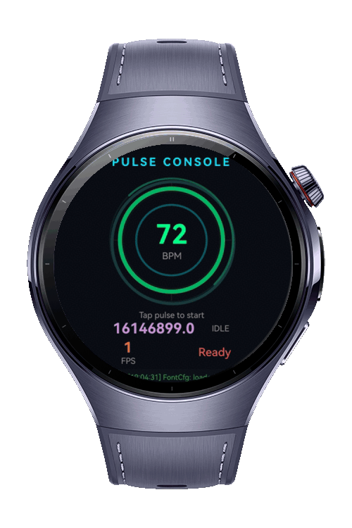
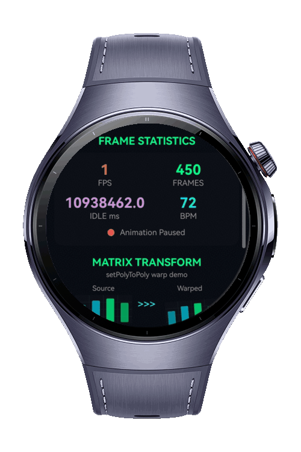
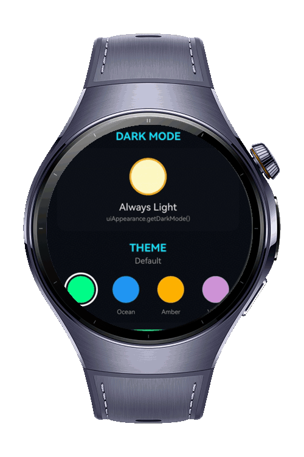

> **Note:** To access all shared projects, get information about environment setup, and view other guides, please visit [Explore-In-HMOS-Wearable Index](https://github.com/Explore-In-HMOS-Wearable/hmos-index).

# How To Make Pulse Animation Console

How To Make Pulse Animation Console is a lightweight HarmonyOS wearable demo application that lets users interact with a pulse-style animation console while monitoring live BPM, FPS, idle time, appearance settings, and multiple kit-driven UI behaviors.

# Preview

<div>
  
  
  
</div>

# Use Cases
1. When the user opens the app, the main pulse console screen is displayed immediately.
2. The user taps the center pulse ring to start or pause the pulse animation.
3. The main page shows live BPM, FPS, idle time, status text, and short runtime console logs.
4. The user opens the Details page to inspect frame statistics, font configuration output, and a `matrix4.setPolyToPoly()` warp demo.
5. The user opens the Appearance page to inspect dark mode detection, switch theme accent colors, and see a custom font preview.
6. Selecting a theme color on the Appearance page instantly updates the accent color across all three pages (pulse ring, BPM value, section titles).

# Technology

## Stack

- **Languages**: ArkTS, ArkUI
- **Frameworks**: HarmonyOS 6.0.1
- **Tools**: DevEco Studio 6.0.1, Hvigor
- **Libraries**: @kit.ArkUI, @ohos.animator, @ohos.font, @ohos.matrix4, @ohos.uiAppearance, @ohos.arkui.theme, @ohos.arkui.StateManagement

**Target Modules & Methods**

| Module | Method | Usage |
|---|---|---|
| `animator (@ohos.animator)` | `.create` | Pulse animation timing via `UIContext.createAnimator` |
| `Font (@kit.ArkUI.Font)` | `.registerFont` | Custom font registration via `UIContext.getFont()` |
| `font (@ohos.font)` | `.getUIFontConfig` | Read system font configuration |
| `FrameCallback (@kit.ArkUI.FrameCallback)` | `.onIdle` | Frame-level callback and idle-time monitoring |
| `matrix4 (@ohos.matrix4)` | `.setPolyToPoly` | Perspective warp transform on UI elements |
| `StateManagement (@ohos.arkui.StateManagement)` | `AppStorageV2.connect` | Shared observable state across components |
| `theme (@ohos.arkui.theme)` | `ThemeControl.setDefaultTheme` | Dynamic theme switching |
| `uiAppearance (@ohos.uiAppearance)` | `.getDarkMode` | Detect system dark mode setting |

# Directory Structure

```
entry
`---src
    `---main
        |---ets
        |   |---entryability
        |   |       EntryAbility.ets          # Ability init, theme & state setup
        |   |
        |   |---pages
        |   |       Index.ets                 # Main console (Navigation root)
        |   |
        |   `---views
        |           AppearanceView.ets        # NavDestination: dark mode, theme, font
        |           PulseDetailView.ets       # NavDestination: frame stats, matrix demo
        |
        `---resources
            |---base
            |   |---element                   # color.json, string.json, float.json
            |   |---media
            |   `---profile
            |
            `---rawfile
                    PulseMono.ttf             # Font asset (demo placeholder)
                    console_ring.svg          # Ring gauge background
                    frame_grid.svg            # Grid bar chart for matrix demo
                    pulse_wave.svg            # Heartbeat waveform decoration
                    theme_preview.svg         # Color palette preview
```

# Constraints and Restrictions

## Supported Devices

* Huawei Watch 5

# License

This project is distributed under the terms of the **MIT License**.
See the [LICENSE](LICENSE) for more information.
